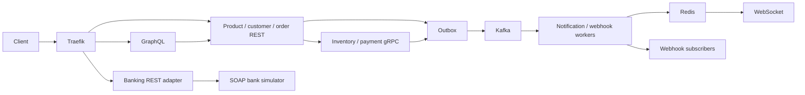

# Order Management Platform

A Java 21 / Spring Boot 4.1 reference application combining REST, GraphQL, gRPC,
WebSocket, webhooks and SOAP in an e-commerce order journey.

## Current status

The eighteen-module reactor contains ten executable services and shared domain,
web, event, gRPC integration and generated protobuf libraries. [TASKS.md](TASKS.md) tracks remaining
requirements; [the implementation report](docs/task-implementation-report.md)
records executed checks. Unchecked requirements remain open.

| Scope | Implemented | Remaining acceptance |
|---|---|---|
| REST | Product/customer APIs, owned orders, durable resource references, fulfillment and compensation | Versioned public contracts and complete recovery journeys |
| GraphQL | Aggregation, batching, mutations, query limits and production policy | Full consumer contracts and deployed verification |
| gRPC | Inventory/payment operations, streaming APIs and mTLS configuration | Streaming transport cases, replica behavior and certificate rotation |
| Events/WebSocket | Outboxes, Kafka/Redis bridge, ownership, private notifications and unsubscribe cleanup | Replay/durability, replica recovery and load acceptance |
| Payments/webhooks | Idempotency, provider refunds, reconciliation, signing, retries and DLQ management | Complete security, provider delivery and recovery acceptance |
| SOAP | Banking facade/simulator, WS-Security, fault mapping and frozen contracts | Deployed trusted TLS and resilience acceptance |
| Operations | Compose, telemetry, alerts and CI workflows | Security/performance/recovery evidence and release approval |

Before the current dependency migration, the accepted baseline passed 999 Java
tests, ten external core journeys, client tests, static analysis and all ten
image builds on GitHub. Its NVD scan correctly blocks vulnerable dependencies.
The [security baseline migration](docs/dependency-security-baseline.md) upgrades
the runtime and preserves the existing transport/JSON contracts. Focused HTTP
and gRPC integration checks pass; complete migration verification is in progress.
Remaining feature work, required branch protection and production acceptance are
tracked separately.

## Development setup

Use Docker Engine/Desktop with Compose **2.24.4+**, Bash and OpenSSL. Allow at least
6 GB to Docker for the core stack; all telemetry services and container tests
together may require more. Host verification also needs Java 21 and Python 3.11+
(CI uses Python 3.12). The checked-in Maven wrapper downloads Maven.

From the project root:

```bash
cp .env.example .env
bash scripts/ci-setup.sh
docker compose -f docker-compose.yml -f docker-compose.e2e.yml \
  up -d --build --wait --wait-timeout 600 \
  traefik product-service customer-service order-service \
  inventory-service payment-service notification-service
```

The opt-in development overlay selects Apache Kafka with a separate data volume,
initializes service database passwords on fresh volumes, connects routed services
to Traefik, and publishes mTLS gRPC/notification management ports on loopback.
It uses a deterministic development payment provider. Existing databases and
realms are not migrated by initialization scripts; see [external e2e setup](docs/external-e2e.md).
Production topology and secret/certificate rotation remain separate work.

The [GitHub repository](https://github.com/vamegah/order-management-platform) now
contains the published baseline and executed workflows. The migration is being
verified in [draft PR #1](https://github.com/vamegah/order-management-platform/pull/1)
before replacing that baseline on `main`.

Development realm logins are `alice` / `alice-dev-password` and `admin` /
`admin-dev-password`. Keycloak administration uses `.env`. Alice's managed
`customer_id` identifies the seeded customer; explicitly imported scopes supply
role claims. These credentials and password grants belong only to development.

| Endpoint | Purpose |
|---|---|
| http://keycloak.localhost | Development identity provider |
| http://product-service.localhost/api/v1/products | Product REST API |
| http://customer-service.localhost/api/v1/customers | Customer REST API |
| http://order-service.localhost/api/v1/orders | Order REST API |
| ws://notification.localhost/ws | Authenticated STOMP/SockJS endpoint |
| `localhost:9091` / `localhost:9093` | Inventory/payment gRPC with mTLS |
| http://localhost:18085/actuator/prometheus | Authenticated notification metrics |

Start additional services explicitly with the same Compose files. GraphQL routes
at `http://graphql.localhost/graphql`; the banking facade routes at
`http://banking.localhost`. Their deployed acceptance is tracked in the backlog.

## Verification

Run from the repository root:

```bash
python -m unittest discover -s scripts/tests -v
bash scripts/tests/test_maven_wrapper.sh
./mvnw -Pstatic-analysis clean verify
python scripts/check_verification.py
python scripts/check_static_analysis.py
python scripts/check_packaging.py
python scripts/check_soap_contracts.py
```

For the external order/refund/WebSocket journeys, start the dedicated stack above
and run `./mvnw -pl integration-tests -am -Pe2e verify`. Full acceptance uses
`./mvnw -Pstatic-analysis,e2e clean verify` followed by
`python scripts/check_verification.py --include-e2e`. Default verification includes
its own packaged payment/notification journey; external suites additionally
require the running development stack. Use a dedicated mutable test environment.

See [verification phases](docs/test-phases.md), [quality gates](docs/quality-gates.md)
and [contract evolution](docs/contract-evolution.md) for thresholds, PR-base checks,
dependency policy, SBOM and evidence requirements.

The supported [notification client package](clients/notifications/README.md) emits
JavaScript and TypeScript declarations. In `clients/notifications`, run
`npm ci --ignore-scripts`, `npm test` and `npm pack` with Node 24+ (CI uses 24).
Its optional `npm run test:deployed` requires the dedicated core stack.

## Common operations

```bash
docker compose -f docker-compose.yml -f docker-compose.e2e.yml ps
docker compose -f docker-compose.yml -f docker-compose.e2e.yml logs -f order-service
docker compose -f docker-compose.yml -f docker-compose.e2e.yml down
```

`down` preserves database volumes. Reinitializing a realm/database requires a
dedicated environment or migration; do not remove unrelated volumes. Generated
development certificates are excluded from Git and Docker build contexts.

## Architecture and documentation



PostgreSQL schemas belong to individual services; cross-service operations use
their APIs. Keycloak issues JWTs; internal inventory/payment calls use mTLS and
relay authorization. Telemetry is configured through Prometheus, structured logs
and OpenTelemetry. Cross-protocol tracing, operational recovery and production
scaling still require their own acceptance.

See the [documentation index](docs/README.md), [phase scope](docs/phases.md),
[architecture decisions](docs/adr/README.md) and
[historical retrospectives](docs/retrospectives/README.md).
