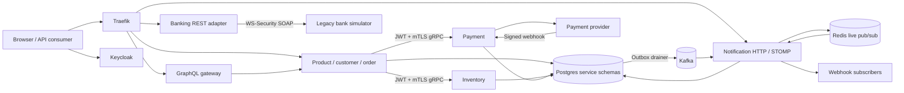

# Architecture and trust boundaries

Reviewed against the implementation on 2026-11-06. This is the current reference
topology; [TASKS.md](../../TASKS.md) records production and operational acceptance.
The [API catalogue](api-catalogue.md) maps protocols to implementation contracts.

The diagram groups callers for readability. Outbox draining runs inside each
producer service, not as a database process. GraphQL uses authenticated REST
clients and bounded batch reads; it does not read service databases directly.

| Boundary | Implemented behavior | Acceptance limit |
| --- | --- | --- |
| Browser to ingress | Development localhost routes; production HTTPS overlay | Production deployment, rate limits and complete API review remain open |
| Issuer to resource servers | JWT signature/issuer validation, realm roles and managed customer claim | Production client credentials, audience policy and secret rotation require review |
| Internal inventory/payment RPCs | TLS, original CA, required client certificate and bearer authentication | Rotation, all-RPC authorization, deadline/cancellation and negative mTLS acceptance remain open |
| Management listeners | Health/info and authenticated metrics policies per service | Prometheus scrape identity provisioning and cross-protocol observability remain open |
| Event producers to Kafka | Transactional outbox in implemented producers; idempotent publication configuration | Delivery is not an exactly-once business guarantee; full adoption/replay review remains open |
| Kafka/Redis to browser | Owner-checked subscriptions, stable subject/private queue and live fan-out | Redis pub/sub has no replay cursor; replica replacement, expiry closure and load acceptance remain open |
| External webhook subscribers | Persisted delivery attempts, signatures, retry/DLQ management | URL/DNS/SSRF policy, retention and safe production egress remain open |
| Banking boundary | Adapter-generated UsernameToken/Timestamp, structured faults and frozen WSDL/XSD | REST access policy, trusted deployed TLS, rotation and resilience remain open |

Development uses HTTP issuer/REST addresses and local credentials. Those fixtures
are for the dedicated acceptance environment. The default `basic` scope provides
`sub`; the managed `customer_id` claim maps Alice to the seeded customer. Users
must not be able to edit their ownership claim. See [identity setup](../external-e2e.md).

Each business service owns its schema/role. Shared DTO/protobuf/event libraries
are build-time contracts, not permission to query another service's tables.
Inventory disables its application HTTP connector and exposes a separate
management listener. Payment has both gRPC and its REST/provider-webhook boundary.
The banking REST facade does not inherit the core services' JWT policy merely
because Traefik routes it; production exposure needs its own accepted policy.

Checkout creates external inventory/payment resources across independent local
transactions. Its durable acceptance journal and persisted references support
recovery after response loss. The order's database transaction is not a distributed
transaction spanning those services. Cancellation/compensation and shipment record
intent and queued work so uncertain outcomes can be reconciled. Use the exact
[state contract](../order-state-contract.md), [cleanup](../order-cleanup.md),
[fulfillment](../order-fulfillment.md), and [refund](../payment-refunds.md) procedures.
Do not infer that a recorded cancellation means every remote provider action has
already completed.

Inventory/payment gRPC stream registries are process-local. The supported overlay
constrains each to one replica and stop-first updates/rollbacks; they have a service
interruption on replacement. [The topology gate](../grpc-stream-topology.md) must
run after deployment overrides. Notification uses Redis for live cross-process
fan-out, but that alone does not establish replay or accepted multi-replica recovery.

The [notification client](../../clients/notifications/README.md) treats events as
invalidation hints. It refreshes credentials, restores subscriptions and reconciles
canonical API state after reconnect, after hints and periodically. Consumers must
not reconstruct a complete transition history from lossy live delivery.

Use [development acceptance](../runbooks/development-acceptance.md) to reproduce
the core stack and [incident triage](../runbooks/incident-response.md) to preserve
evidence and choose a bounded recovery action. Image signing, secret management,
production receivers, backup restore and rollback still need executed procedures;
the presence of a Compose overlay does not establish that acceptance.
