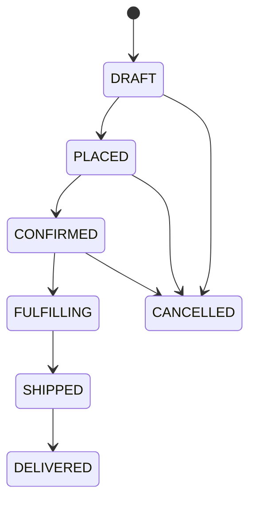

# Order Service

REST API for order management. Orchestrates product-service and
customer-service to fulfill customer orders.

Part of the [Order Management Platform](../README.md).

## Endpoints

All endpoints under `/api/v1/orders`.

| Method | Path | Auth | Description |
|--------|------|------|-------------|
| `GET` | `/api/v1/orders` | Admin | List orders with filters |
| `GET` | `/api/v1/orders/{id}` | Owner or admin | Get an order by ID |
| `GET` | `/api/v1/orders/number/{orderNumber}` | Owner or admin | Get by business identifier |
| `POST` | `/api/v1/orders` | Matching customer or admin | Create a DRAFT order |
| `POST` | `/api/v1/orders/{id}/place` | Owner or admin | DRAFT → PLACED |
| `POST` | `/api/v1/orders/{id}/confirm` | Admin | PLACED → CONFIRMED |
| `POST` | `/api/v1/orders/{id}/ship` | Admin | CONFIRMED → FULFILLING → SHIPPED; 202 while pending |
| `POST` | `/api/v1/orders/{id}/deliver` | Admin | SHIPPED → DELIVERED |
| `POST` | `/api/v1/orders/{id}/cancel` | Owner or admin | → CANCELLED |

Owner access requires a canonical UUID `customer_id` claim in the verified JWT.
Creation must target that customer; reads and owner actions check persisted
ownership. Claimless legacy tokens cannot use owner routes. See
[the access policy and verification scope](../docs/order-verification.md).

## Order Status Lifecycle



Transition rules are enforced by the `Order` entity's state machine
(`OrderStatus.canTransitionTo`). Illegal transitions return HTTP 409.

## Cross-Service Dependencies

Order-service is the platform's **orchestrator**. When you create an order,
it:
1. Calls `customer-service` to fetch the customer.
2. Calls `product-service` (once per line) to fetch product details.
3. **Snapshots** product details (SKU, name, price) and the shipping
   address into the order — later changes to the product or the customer
   don't affect existing orders.

Both calls are made via Feign clients with:
- **JWT propagation** — the caller's token is forwarded.
- **Trace propagation** — the `traceparent` header continues the trace.
- **Circuit breakers** — after repeated failures, calls short-circuit (fast
  fail) for 10 seconds.

If a downstream service is down, order creation fails with:
- **400** — product or customer not found (business error).
- **502** — downstream returned 5xx (system error).

## Environment Variables

| Variable | Default (dev) | Purpose |
|----------|---------------|---------|
| `SPRING_PROFILES_ACTIVE` | `local` | Spring profile |
| `SPRING_DATASOURCE_URL` | `jdbc:postgresql://postgres:5432/omp?currentSchema=orders,public` | JDBC URL |
| `SPRING_DATASOURCE_USERNAME` | `orders_svc` | DB role |
| `SPRING_DATASOURCE_PASSWORD` | (from `.env`) | DB password |
| `OIDC_ISSUER_URI` | `http://keycloak.localhost/realms/omp` | JWT issuer |
| `OIDC_JWK_SET_URI` | `http://keycloak:8080/...` | JWKS endpoint |
| `PRODUCT_SERVICE_URL` | `http://product-service:8081` | Downstream service |
| `CUSTOMER_SERVICE_URL` | `http://customer-service:8082` | Downstream service |
| `OTEL_EXPORTER_OTLP_ENDPOINT` | `http://otel-collector:4317` | Trace exporter |
| `PROMETHEUS_ENV` | `dev` | Metrics environment label |
| `SERVER_PORT` | `8083` | HTTP port |

## Development

```bash
# Build
./mvnw -pl order-service clean package

# Run tests (uses WireMock for downstream services)
./mvnw -pl order-service verify

# Run locally (needs postgres, keycloak, and the two downstream services)
docker compose up -d postgres keycloak product-service customer-service
./mvnw -pl order-service spring-boot:run

Testing
Integration tests use WireMock to stub product-service and
customer-service. Each test defines the stubs it needs:

java
WireMockDownstreamConfig.stubProduct(productId, "SKU-1", "Product", "9.99", "USD");
WireMockDownstreamConfig.stubCustomer(customerId, "a@b.com", "A", "B");
Failure-path tests stub downstream errors:

java
WireMockDownstreamConfig.stubProductNotFound(productId);
WireMockDownstreamConfig.stubProductServerError(productId);
See WireMockDownstreamConfig for the full set of helpers.

Observability
Metrics: /actuator/prometheus — includes Feign client metrics and
circuit breaker state (from Resilience4j).

Logs: stdout as JSON — Promtail ships to Loki.

Traces: exported via OTLP to the OTel Collector.

Dashboard: OMP — Order Service in Grafana, including a downstream
health row.

Troubleshooting
Order creation returns 502.

A downstream service is failing. Check:

bash
docker compose logs product-service customer-service | tail -50
The response body includes the downstream service name and the specific error.

Circuit breaker is open (immediate failures).

Check the state:

bash
curl http://localhost:8083/actuator/health
Or in Prometheus:

promql
resilience4j_circuitbreaker_state{name="productClient"}
The breaker auto-closes 10 seconds after the downstream recovers.

Order number generation fails.

The orders.order_number_seq sequence must exist. Verify:

bash
docker compose exec postgres psql -U omp_admin -d omp -c "SELECT nextval('orders.order_number_seq');"
Related Documentation
Platform README

ADR-0001: Schema-per-service

ADR-0002: Promtail for logs
## Order lines

Public order lines are immutable after creation, including while the order is DRAFT. To change items, cancel the order and create a replacement. There is no order-line mutation or ping endpoint. Checkout stores a reservation reference for each line in the same database transaction as the order. Cancellation retries release calls for those references; legacy rows without references still require reconciliation.


## Event durability and cleanup

Order lifecycle events use the transactional outbox. Cancellation records durable cleanup tasks before attempting inventory/payment cleanup. Admins can retry due tasks using `POST /api/v1/order-cleanup/{orderId}/retry`; an opt-in background worker discovers IDs lost to timeouts using a checkout journal and a rotating service JWT. Supervised development identity and scheduled deployed recovery pass PR #16/main acceptance. Complete failure injection, accepted-order expiry and production identity acceptance remain open. See [cleanup operations and limits](../docs/order-cleanup.md).

Create requests support 1-100 lines with distinct SKUs. Combine repeated SKU quantities into a single line so each line has its own inventory reservation.


See the [state and concurrency contract](../docs/order-state-contract.md) for implemented validation, replay/error behavior, and remaining lifecycle acceptance.


Confirmation and shipment verify the linked payment through a bounded gRPC read before changing local state. The response must match the order/customer/total/currency and be fully confirmed with a provider reference. The local transaction checks the order version again; unpaid/refunded or stale initial transitions return 409. Missing/malformed dependency responses fail closed, and upstream failures before intent acceptance return redacted 502 problems.

Shipment now persists a FULFILLING intent and reservation commit tasks before RPCs. It returns HTTP 202 while work remains and HTTP 200 once SHIPPED. Cancellation is rejected after FULFILLING begins. A disabled-by-default worker can resume pending work with a rotating workload JWT. Payment is checked before retries and finalization. Cross-service refund races, permanent-failure recovery and deployed acceptance remain open. See [fulfillment operations and compatibility](../docs/order-fulfillment.md).

## Historical reference operations

Administrators can inspect missing/shared references through the bounded census,
restore verified existing holds through the repair endpoint, and record an
audited exception for an eligible historical DELIVERED/CANCELLED order with no
recoverable hold. The exception requires upgrade-captured eligibility, a complete
version-checked plan, verified subject, reason and evidence. It changes metadata
audit/version only; active and future orders retain their reference requirements.
See [the repair and terminal disposition procedure](../docs/order-reservation-repair.md).

Every forward state change requires 1-100 order lines with distinct non-NULL
reservation IDs. Missing/shared legacy pointers return 409 before changing local
state/history/events. Checkout and audited repair provide separate remote
verification; these shape checks do not prove hold ownership or current remote
state. Normal cancellation stays available for unresolved historical orders in
its allowed states. See the [reference integrity contract](../docs/order-state-contract.md#reference-integrity-on-forward-transitions).
