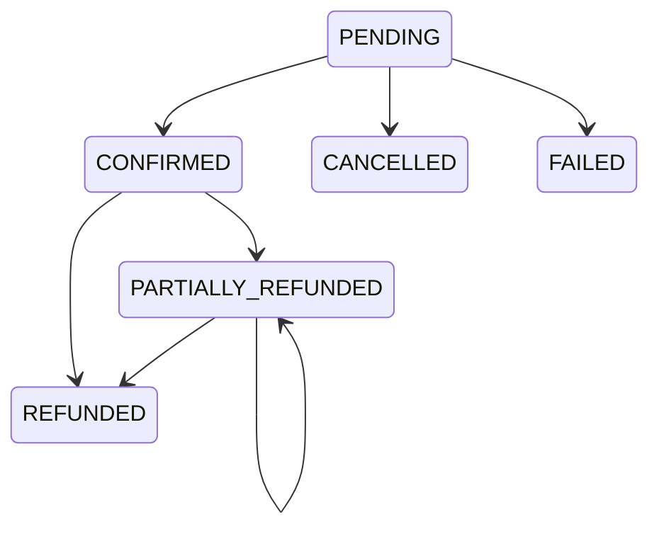

# Payment Service

Payment intents, confirmations, cancellations, provider charges, and refunds.
Part of the [Order Management Platform](../README.md).

The internal gRPC API runs on port 9093. The HTTP API exposes:

- `POST /api/v1/payments`: charge using the authenticated JWT's `customer_id`.
- `GET /api/v1/payments/{id}`: read a payment as its owner or an administrator.
- `POST /api/v1/payments/{id}/refunds`: request a refund as its owner or an administrator.
- `POST /api/v1/payments/webhooks/{provider}`: receive signed provider events.

Payment HTTP operations require a JWT. Provider webhooks authenticate the raw
request body using the provider signature and reject bodies over 256 KiB.
Amounts use the currency's minor units (USD cents, JPY yen), without rounding.
Repeated charge/refund keys must refer to the same request details.

Provider event IDs are recorded durably. Payment changes and their outbox events
share a database transaction. Refunds use durable intents and provider-backed completion across REST/gRPC;
see the [refund workflow](../docs/payment-refunds.md) for pending outcomes,
webhooks, safe retries and remaining reconciliation acceptance.

## Service Definition

The gRPC API is defined in
[`shared/proto/src/main/proto/payment/payment.proto`](../shared/proto/src/main/proto/payment/payment.proto).

### RPC Methods

| Method | Type | Purpose |
|--------|------|---------|
| `CreatePaymentIntent` | Unary | Record a payment intent for an order |
| `GetPayment` | Unary | Fetch a payment by ID (includes refund history) |
| `ConfirmPayment` | Unary | Confirm after external provider succeeds |
| `CancelPayment` | Unary | Cancel a pending intent |
| `RefundPayment` | Unary | Full or partial refund |
| `StreamPaymentEvents` | Server streaming | Subscribe to payment state changes |

### Error Model

| Code | Trigger |
|------|---------|
| `NOT_FOUND` | Payment or refund doesn't exist |
| `FAILED_PRECONDITION` | Illegal state transition (e.g., refund a cancelled payment) |
| `ALREADY_EXISTS` | Idempotency key conflict that couldn't be resolved transparently |
| `INVALID_ARGUMENT` | Malformed request, invalid amount, currency mismatch |
| `INTERNAL` | Unexpected server error |

## Payment Lifecycle



**Transitions:**

- `PENDING → CONFIRMED` — called after the external provider charges the card.
- `PENDING → CANCELLED` — customer or admin cancels before confirmation.
- `PENDING → FAILED` — external provider rejects the charge.
- `CONFIRMED → PARTIALLY_REFUNDED` — first partial refund.
- `CONFIRMED → REFUNDED` — full refund.
- `PARTIALLY_REFUNDED → REFUNDED` — final refund completes the total.

**No transition out of terminal states.** Attempts return `FAILED_PRECONDITION`.

## Idempotency

Keyed payment creation is serialized across REST/gRPC using a database advisory
lock and validates payment identity and money on replay. Blank gRPC creation keys
remain optional. New refunds require a key and validate payment, amount/currency
and reason even on completed replays. A pending refund reserves the payment
balance until a verified final outcome.

See [payment creation contracts](../docs/payment-idempotency-contract.md) and
[refund replay rules](../docs/payment-refunds.md).

## Refunds

REST and gRPC commit a pending intent before contacting the configured provider.
Successful outcomes update the balance and commit a canonical partial/full refund
event through the transactional outbox. Pending provider outcomes complete through
correlated webhooks. Request retries return the same intent; uncertain responses
reuse its provider key within the documented replay window.

An opt-in recovery worker reads known provider refunds when webhooks are missing.
It persists attempts/backoff and flags unsafe retries for attention. Owners can
inspect `GET /api/v1/payments/{id}/refunds/{refundId}`; administrators can retry
that existing intent with `POST .../{refundId}/retry`. See
[recovery settings, permissions and metrics](../docs/payment-refunds.md).

Administrators can also reconcile a ledger reference through
`POST .../{refundId}/reconciliation`. The server verifies the original refund
metadata and records actor, reason and outcome; the matching GET returns recent
audit history. See [operator reconciliation](../docs/refund-reconciliation.md).

REST returns 202 while pending, 200 when completed and 422 on failure. gRPC returns
the corresponding refund status. Owners, administrators and the trusted internal
recovery scope may initiate refunds. Omitted gRPC amounts bind the remaining
balance once. See [refund operations and rollout](../docs/payment-refunds.md).

## Provider integration

REST charging and refunds call the configured Stripe or development noop provider.
Stripe charging still contains a test payment-method placeholder; SCA, real
client payment methods and production provider acceptance remain backlog work.

gRPC CreatePaymentIntent creates local PENDING state and records the configured
provider without charging. ConfirmPayment records a trusted provider result.
Broader confirmation authorization and webhook/deployed acceptance remain open.
Production callers must not treat a supplied reference as proof that money moved.

## Money Handling

Payments deal in monetary amounts. Two representations coexist:

- **Proto `Money`** (`common/money.proto`) — the wire format. `amount` is a
  string to preserve decimal precision.
- **Domain `Money`** (`shared/domain`) — the Java value object. Immutable,
  validated (non-negative, valid currency), with arithmetic methods.

`MoneyConverter` bridges the two. All conversions go through it.

## Environment Variables

| Variable | Default (dev) | Purpose |
|----------|---------------|---------|
| `SPRING_PROFILES_ACTIVE` | `local` | Spring profile |
| `SPRING_DATASOURCE_URL` | `jdbc:postgresql://postgres:5432/omp?currentSchema=payments,public` | JDBC URL |
| `SPRING_DATASOURCE_USERNAME` | `payments_svc` | DB role |
| `SPRING_DATASOURCE_PASSWORD` | (from `.env`) | DB password |
| `OIDC_ISSUER_URI` | `http://keycloak.localhost/realms/omp` | JWT issuer |
| `OIDC_JWK_SET_URI` | `http://keycloak:8080/...` | JWKS endpoint |
| `OTEL_EXPORTER_OTLP_ENDPOINT` | `http://otel-collector:4317` | Trace exporter |
| `PROMETHEUS_ENV` | `dev` | Metrics environment label |
| `GRPC_PORT` | `9093` | gRPC server port |
| `GRPC_REFLECTION_ENABLED` | `true` (dev), `false` (prod) | grpcurl reflection |
| `MANAGEMENT_PORT` | `9094` | Actuator HTTP port |

## Development

```bash
# Build
./mvnw -pl payment-service clean package

# Run locally (requires postgres + keycloak)
docker compose up -d postgres keycloak otel-collector
./mvnw -pl payment-service spring-boot:run

Verify it's up
bash
curl http://localhost:9094/actuator/health
# Expected: {"status":"UP"}
Calling the Service
Get a JWT
bash
TOKEN=$(curl -s -X POST http://keycloak.localhost/realms/omp/protocol/openid-connect/token \
  -d "grant_type=password" -d "client_id=postman" \
  -d "username=alice" -d "password=alice" | jq -r '.access_token')
Create a payment intent
bash
docker compose exec payment-service \
  grpcurl -plaintext \
    -H "Authorization: Bearer $TOKEN" \
    -d '{
      "order_id": "00000000-0000-0000-0000-000000000303",
      "customer_id": "00000000-0000-0000-0000-000000000101",
      "amount": {"amount": "2598.0000", "currency": "USD"},
      "idempotency_key": "order-303-payment-1"
    }' \
    localhost:9093 omp.payment.PaymentService/CreatePaymentIntent
Expected response (a JSON-serialized Payment):

json
{
  "id": "00000000-0000-0000-0000-000000000803",
  "orderId": "00000000-0000-0000-0000-000000000303",
  "customerId": "00000000-0000-0000-0000-000000000101",
  "amount": {"amount": "2598.0000", "currency": "USD"},
  "status": "PAYMENT_STATUS_PENDING",
  "createdAtEpochMillis": "1705334400000",
  "updatedAtEpochMillis": "1705334400000"
}
Confirm the payment
bash
docker compose exec payment-service \
  grpcurl -plaintext \
    -H "Authorization: Bearer $TOKEN" \
    -d '{
      "payment_id": "00000000-0000-0000-0000-000000000803",
      "provider_reference": "pi_test_12345"
    }' \
    localhost:9093 omp.payment.PaymentService/ConfirmPayment
Refund (partial)
bash
docker compose exec payment-service \
  grpcurl -plaintext \
    -H "Authorization: Bearer $TOKEN" \
    -d '{
      "payment_id": "00000000-0000-0000-0000-000000000803",
      "amount": {"amount": "500.0000", "currency": "USD"},
      "reason": "Partial refund — damaged item",
      "idempotency_key": "refund-803-1"
    }' \
    localhost:9093 omp.payment.PaymentService/RefundPayment
Subscribe to payment events
Server-streaming. grpcurl streams responses continuously:

bash
docker compose exec payment-service \
  grpcurl -plaintext \
    -H "Authorization: Bearer $TOKEN" \
    -d '{"order_id": "00000000-0000-0000-0000-000000000303"}' \
    localhost:9093 omp.payment.PaymentService/StreamPaymentEvents
# Press Ctrl+C to cancel.
List services (reflection)
bash
docker compose exec payment-service \
  grpcurl -plaintext localhost:9093 list
# Expected:
#   grpc.health.v1.Health
#   grpc.reflection.v1alpha.ServerReflection
#   omp.payment.PaymentService
Testing

Clean focused verification passes 221 unit/in-process tests and all sixteen
PostgreSQL/Kafka integration cases. The unchanged 80% instruction gate passes at
82.39%. Tests cover committed creation/refund recovery, provider application
flows, HTTP payload/status contracts, raw webhook forwarding and stream
lifecycle/filtering behavior.

See [payment verification](../docs/payment-verification.md) for the exact scope,
test-double boundaries and deployed identity/transport/provider acceptance that
remains open.

```sh
./mvnw -pl payment-service -am clean verify
```

Observability
Metrics: /actuator/prometheus on port 9094. Includes grpc_server_*
metrics for every RPC.

Logs: JSON to stdout; Promtail ships to Loki.

Traces: exported via OTLP to the OTel Collector.

Known Limitations
Server-streaming subscriptions don't fan out across replicas. Same
as inventory-service. The supported overlay constrains both to one replica with
stop-first updates and rollbacks. See [stream topology and recovery](../docs/grpc-stream-topology.md).

Refund intents and correlated webhook completion are implemented. PostgreSQL,
deployed provider delivery and recovery acceptance remain open. Missing-webhook
GET reconciliation and administrator retries are implemented; unknown-reference
expired intents and legacy records still require a ledger audit. See
[refund limits](../docs/payment-refunds.md).

gRPC rate limiting remains open, as for inventory-service.

Troubleshooting
Client gets FAILED_PRECONDITION on confirm.

The payment isn't in PENDING (already confirmed, cancelled, or failed).
Check the current status:

bash
docker compose exec payment-service \
  grpcurl -plaintext -H "Authorization: Bearer $TOKEN" \
    -d '{"payment_id": "..."}' \
    localhost:9093 omp.payment.PaymentService/GetPayment
Refund exceeds remaining balance.

The refund amount must be ≤ (payment amount − refunded amount). Check the
payment's refundedAmount via GetPayment.

Idempotency key collision on a different request.

Changed content under an existing key is rejected. Payment creation validates
order, customer and money; refunds validate payment, amount/currency and reason.
Use a new key only for a new operation after resolving any uncertain outcome.

Streaming subscription silent.

Same as inventory-service. Multiple replicas don't share subscriptions.
See "Known Limitations."

Related Documentation
Platform README

ADR-0005: gRPC for internal services

Shared proto definitions

gRPC Java documentation


## Recovery lookups

The additive order-ID recovery RPC requires `SCOPE_order.reconcile`, returns at most 100 resources, and performs no mutations. This supports discovery after checkout response loss. See [order recovery operations](../docs/order-cleanup.md) for service-identity provisioning and remaining deployment acceptance.


See the [state and concurrency contract](../docs/payment-idempotency-contract.md) for implemented validation, replay/error behavior, and remaining lifecycle acceptance.
